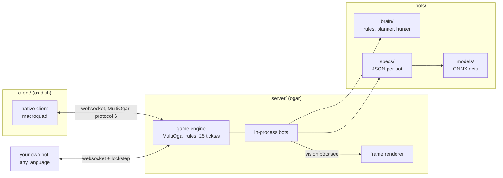
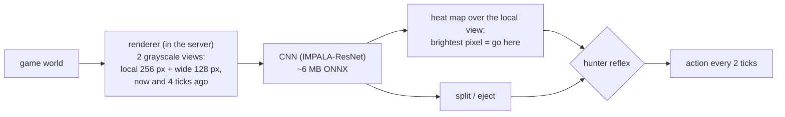
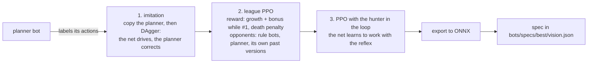

# oxidish

**A neural net that plays agar.io from pixels, and the Rust server it learned in.**

The best bot here watches grayscale frames of the game, the same view a human player gets, and decides where to
move. Against bots it never trained against it is #1 on the leaderboard 64% of the time. It still loses to a good
human. Everything that got it there is in this repo: a Rust port of the MultiOgar agar.io server, the rule bots and
planner it learned from, the training code, and a native client to play against them.


## Play in two minutes

Download the bundle for your system from the [releases page](https://github.com/hkinks/oxidish/releases)
(`oxidish-…-win-x64.zip` or `oxidish-…-linux-x64.tar.gz`). Everything is included: server, client, bots, models and
ONNX Runtime. Unpack it and start the server with the four best bots, then the client:

```bash
./ogar serve --port 9600 --bots 12 --food-mult 2 --map 10000 --control-port 9601 \
  --agents vision=bots/specs/best/vision.json:4 vision-old=bots/specs/best/vision-old.json:4 \
           planner=bots/specs/best/planner.json:4 rules=bots/specs/best/rules.json:4
./oxidish --name you          # second terminal
```

On Windows use `ogar.exe` and `oxidish.exe` and put the command on one line.

| key | does |
|---|---|
| mouse | steer |
| Space / W | split / eject mass |
| Tab, Q | spectate, switch between following a player and the whole map |
| F1 / F2 | settings / server control (speed, pause, add and remove bots) |
| Z | toggle automatic zoom |

`--font ubuntu|nunito|inter|quicksand` changes the client font. The server also takes commands on its stdin or
control port (`add`, `remove`, `list`, `speed`, `pause`, `status`): see [docs/playing.md](docs/playing.md).

## How it fits together



- **`server/` (`ogar`)** is a Rust port of the [MultiOgar](https://github.com/agarian-2/MultiOgar) agar.io server,
  FFA mode. Any client that speaks the MultiOgar protocol connects to it (not the official agar.io client). Bots run
  **inside** the server process, without websockets, which makes headless evaluation fast: a whole match runs about
  300 times faster than real time. We found no other Rust port of the MultiOgar server; there are Rust agar.io clones,
  but they are new games. The port follows the original's rules and config values but is not bit-identical
  ([docs/ogar.md](docs/ogar.md)).
- **`client/` (`oxidish`)** is a native client in Rust (macroquad). It interpolates like the web client and talks the
  same protocol, so it also works with the original Node server.
- **`bots/`** holds what each bot is. `brain/` is the Rust logic for rule bots, the planner and the hunter. A
  **spec** in `specs/` is a small JSON file that picks a brain and its settings, or a vision model in `models/` plus
  reflexes. The server loads specs with `--agents name=spec.json:count`.
- **`training/`** turns games into better bots: `env/` exposes the engine to Python (`oxidish_env`), `rl/` trains
  the vision nets, `eval/` measures and reports.

## How the bots work

Three generations, each stronger than the last:

| bot | spec | how it decides |
|---|---|---|
| **rules** | `best/rules.json` | hand-written behaviours (farm food, flee, chase, split-kill) whose ~50 numeric **genes** (distances, thresholds) were tuned by evolution, plus the hunter |
| **planner** | `best/planner.json` | simulates a few seconds ahead for each candidate heading and picks the safest profitable one, plus the hunter |
| **vision-old** | `best/vision-old.json` | a CNN on rendered frames, trained with reinforcement learning, plus the hunter |
| **vision** | `best/vision.json` | the same net trained further with the hunter active during training (the champion) |

The **hunter** is a rule module all four share: when a big player bursts on a virus, it judges which pieces it can
catch, commits to them and splits onto them only when that is safe. It is the one skill that raised the win rate of
every bot type.

### The vision bot




- **It sees only pixels.** Frames are drawn inside the server from exactly what the protocol would send a player:
  no mass numbers, no threat flags. Its own cells have their own brightness; each other player gets one gray shade.
- **It acts by pointing.** The net outputs a heat map over its local view and the brightest pixel is the cursor
  target, plus split and eject decisions. It decides every 2 server ticks (80 ms).
- **It was trained in three stages:**



Training runs in `oxidish_env`: dozens of worlds per process, stepped as fast as the CPU allows (about 46,000
decisions per second on 16 threads), with the planner available as a teacher at every step. A GPU is needed to
train; playing and evaluating work on the CPU (with CUDA 12 the bots use the GPU automatically).

## Results

The metric is **leader share**: the share of time a bot is #1 on the leaderboard, sampled every 15 s over 8 worlds ×
4 game hours, averaged over 5 seed sets (noise about ±5 points per set). A change counted only if it improved the mean
and won at least 3 of the 5 sets. Two different opponent fields were used, so compare rows only within a table.

Vision bots, against a **held-out field** (opponents they never trained against: planner and imitation-net variants
and a virus-popping hunter, plus 8 server bots):

| bot | leader share |
|---|---|
| vision net, league PPO (p6) | 58% |
| vision-old (p6 + hunter) | 61% |
| **vision** (m7a, hunter in training) | **64%** |

Rule bots, against the field they were evolved in:

| bot | leader share |
|---|---|
| evolved rules (c3_4) | 32% |
| rules (c3_4 + hunter) | 40% |
| planner without hunter | 40% |
| **planner** (+ hunter) | **50%** |

**Against a human**, in an 11-hour live session with 50 players: the vision bots together were #1 30% of the time,
vision-old 25%, the human 7% overall. During the 77 minutes the human was alive they were #1 63% of the time. A good
human still beats every bot.

**The goal was not reached.** The aim was one bot that is #1 80% of the time and can split-kill, pop others with
viruses and eat exploded enemies. Best result: 64%. Eating exploded enemies works (the hunter adds 8-9 points to the rule bots and about 4 to the vision net);
split-kills as a reflex cost 11-31 points because the halves get eaten, and virus-popping cost more than it gained.
What worked, what did not and why is in [docs/learnings.md](docs/learnings.md), probably the most useful page here.

## Build from source

Needs Rust (stable). One Cargo workspace:

```bash
cargo build --release          # server (with vision bots), client, bot brains -> target/release/
```

ONNX Runtime is not needed to build; the vision bots load ONNX Runtime 1.24 at run time: put `onnxruntime.dll` next to `ogar.exe` on Windows, or set
`ORT_DYLIB_PATH=/path/to/libonnxruntime.so` on Linux. On the CPU, 20 vision bots ran at the full 25 ticks/s on a
16-thread machine; on fewer cores, lower the `:count` numbers in `--agents`.

```bash
ORT_DYLIB_PATH=/path/to/libonnxruntime.so target/release/ogar serve --port 9600 --bots 12 --food-mult 2 \
  --map 10000 --control-port 9601 --agents vision=bots/specs/best/vision.json:4 planner=bots/specs/best/planner.json:4
scripts/client.sh --name you          # builds the client if needed and starts it
```

`scripts/client.sh` also sets up the X11/GL libraries the client loads at run time on NixOS.

## Write, test and train your own bot

The fastest start: copy `bots/specs/c3_4.json`, change one gene, and race it against the original in a minute of
headless games. [docs/training.md](docs/training.md) walks through that and covers the rest end to end:

- the three ways a bot can play: as a spec inside the server, as an external program over websocket (protocol
  documented byte by byte, with a lockstep mode so a slow bot never misses a tick), or as a learner in `oxidish_env`;
- testing: watch it live, head-to-head matches, the leader-share evaluation (`scripts/eval.sh`), and drills;
- training faster than real time: server speed control (`speed 0` is unthrottled), gene search, and the vision
  pipeline (`scripts/train.sh`, `scripts/export.sh`).

## Background

Earlier phases (a browser bot driving the web client, a GPU simulator in PyTorch, a Node.js server harness) were
replaced by the Rust server and removed; they are in the git history at tag `python-era` (commit `436fb38`).

## FAQ

- **Does it work on the real agar.io?** No. The bots are for local servers only.
- **Do I need a GPU?** Not to play or evaluate. Training the vision nets does.
- **Contributing?** Issues and pull requests are welcome; [docs/status.md](docs/status.md) lists the open ideas.

## Licence

[WTFPL](LICENSE): do what you want. `server/` is a port of [MultiOgar](https://github.com/agarian-2/MultiOgar),
based on [Ogar](https://github.com/OgarProject/Ogar), so it stays under Apache 2.0
([LICENSE](server/LICENSE), [NOTICE](server/NOTICE)). The bundled fonts keep their own licences. Not affiliated with
agar.io or Miniclip.
