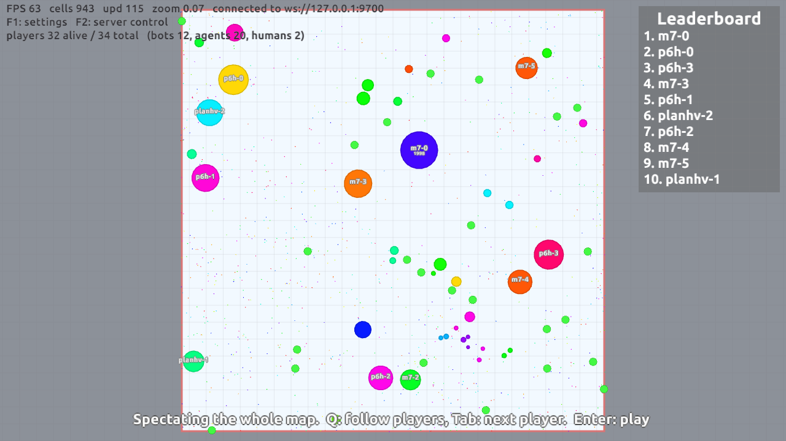
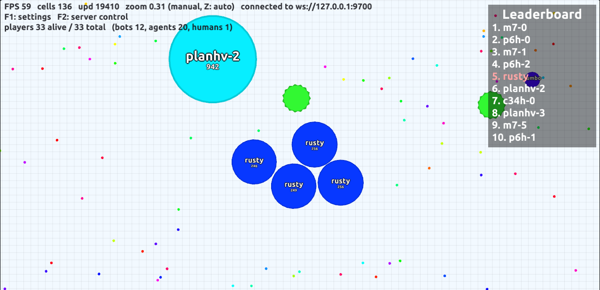

# oxidish

Bots that learn to play agar.io, and a Rust port of the MultiOgar server to train and fight them in.



- **`ogar`**: a Rust port of the MultiOgar agar.io server (FFA). Speaks the MultiOgar protocol, so real agar.io-style
  web clients connect to it, and runs bots in-process with no websockets, which makes headless evaluation fast. As far
  as we know it is the only Rust port of Ogar/MultiOgar.
- **Bots** in three generations: hand-written rules with genes tuned by evolution, a lookahead planner, and **vision
  bots**: a CNN that sees grayscale frames rendered by the server and was trained with league PPO, plus a rule-based
  "hunter" reflex that eats freshly popped giants.
- **`game_client`**: a native client (Rust, macroquad) for playing against them.

  
- Drills (eat a giant that just popped on a virus, escape a hunting human), a GPU simulator, and the training code.

## Results

The metric is **leader share**: how often a bot is #1 on the leaderboard, sampled every 15 s over 8 worlds × 4 game
hours per seed set, against opponents it never trained against (details in [docs/status.md](docs/status.md)).

| bot | what | leader share |
|---|---|---|
| `bot/plan_c34.json` | lookahead planner | 40% |
| `bot/drill/plan_hv_commit_only.json` | planner + hunter | 50% |
| `bot/vision_p6.json` | vision net, league PPO | 58% |
| **`bot/vision_m7a_final.json`** | vision net, PPO with the hunter in the loop | **64%** |

The rule-bot rows are measured in a different field from the vision rows, so compare within each group. In an 11-hour
live session against a human, the best bot (m7) was #1 for 30% of the time, more than anyone else. The human was #1
for 63% of the time they were alive, so a good human still wins.

The goal was one bot that is #1 80% of the time and can split-kill, virus-pop and eat exploded enemies. That was
**not** reached. Eating exploded enemies works; the other skills cost more than they gained. What worked, what didn't
and why is in [docs/learnings.md](docs/learnings.md), probably the most useful page here.

## Quick start

Prebuilt Windows and Linux builds (server, client, models, ONNX Runtime) are on the [releases page](../../releases).
To build from source you need Rust (stable); the vision bots also need ONNX Runtime 1.24.

```bash
# server with the rule bots (no models needed)
cargo build --release --manifest-path rust/ogar/Cargo.toml
rust/ogar/target/release/ogar serve --port 9600 --bots 8 --food-mult 2 --map 7000 --control-port 9601 \
    --agents planhv=bot/drill/plan_hv_commit_only.json:4 c34h=bot/drill/hv_commit_only.json:4

# play
cd rust/game_client && cargo build --release
./target/release/game_client --name you --server ws://127.0.0.1:9600
```

With the vision bots (the models are in `runs/vision/export/`; on Linux point `ORT_DYLIB_PATH` at
`libonnxruntime.so`, on Windows put `onnxruntime.dll` next to `ogar.exe`). The nets use CUDA 12 when it loads and the
CPU otherwise; on the CPU, 20 bots still run at the full 25 ticks/s on a 16-thread machine.

```bash
cargo build --release --features vision-net --manifest-path rust/ogar/Cargo.toml
OGAR_VISION_THREADS=4 rust/ogar/target/release/ogar serve --port 9600 --bots 12 --food-mult 2 \
    --map 10000 --control-port 9601 --agents m7=bot/vision_m7a_final.json:6 p6h=bot/vision_p6_hunt.json:4 \
    planhv=bot/drill/plan_hv_commit_only.json:6 c34h=bot/drill/hv_commit_only.json:4
```

- In the client: the mouse steers, Space splits, W ejects, Tab spectates, F2 opens server control (speed, pause, bots).
  `--font ubuntu|nunito|inter|quicksand` changes the font.
- While the server runs, `add` / `remove` / `list` / `speed` / `status` on its stdin or control port change bots and
  speed live ([docs/showcase.md](docs/showcase.md)).
- `scripts/client.sh [args]` builds and starts the client in one step; on NixOS it also supplies the X11/GL
  libraries macroquad loads at run time.

**Writing, testing and training your own bot:** [docs/training.md](docs/training.md) covers the three ways a bot can
connect (in-process spec, external websocket bot in any language, Python RL environment), evaluation, and training
far faster than real time.

## Layout

```
rust/ogar          server port, headless matches, drills, frame renderer, vision bot inference
rust/arena_client  bot policies: rules, planner, hunter, reflexes
rust/game_client   native client
rust/ogar_py       Python bindings: vectorised envs for training
bot/               bot specs (genes, planner settings, vision model + reflexes)
rl/                PPO / imitation training, ONNX export
arena/             Node MultiOgar harness, tournaments, evolution, reports
sim/               GPU simulator (earlier phase)
docs/              design notes and results; start with docs/status.md
```

The project was developed on Windows with an NVIDIA GPU, so some docs still show Windows paths.

## Licence

[WTFPL](LICENSE): do what you want. `rust/ogar` is a port of
[MultiOgar](https://github.com/agarian-2/MultiOgar), which is based on [Ogar](https://github.com/OgarProject/Ogar),
so it stays under Apache 2.0 ([LICENSE](rust/ogar/LICENSE), [NOTICE](rust/ogar/NOTICE)). The bundled fonts keep their
own licences. Not affiliated with agar.io or Miniclip; the bots are for local servers only.
