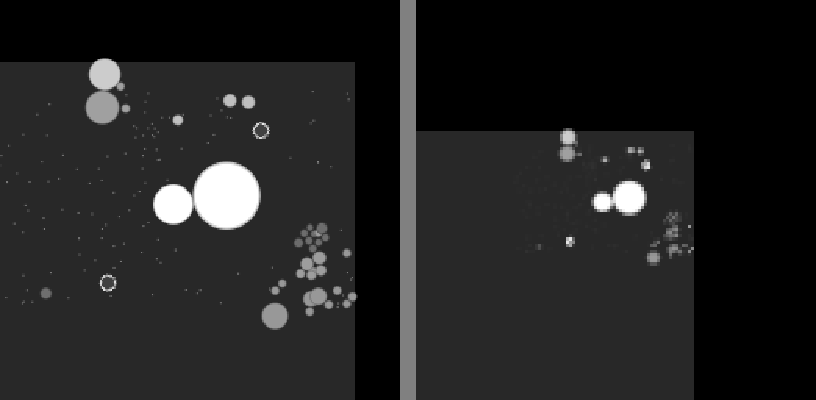

# oxidish

oxidish is an agar.io playground in Rust: a server, bots that range from hand-written rules to a neural net that
plays from raw pixels, the tools to test and train your own bot, and a native client to play against them.

The server is a Rust port of [MultiOgar](https://github.com/agarian-2/MultiOgar), the open-source agar.io server.
It runs bots inside the game loop, so headless matches go hundreds of times faster than real time. The strongest bot
sees only grayscale frames of the game and decides where to move. Against bots it never trained against, it
tops the leaderboard 64% of the time. A good human still beats it.


## Quick start

Download the bundle for your system from the [releases page](https://github.com/hkinks/oxidish/releases)
(`oxidish-…-win-x64.zip` or `oxidish-…-linux-x64.tar.gz`). It contains the server, the client, the bots, their
models and ONNX Runtime. Unpack it, start the server with the four best bots, then start the client in a second
terminal:

```bash
./oxidish-server serve --port 9600 --bots 12 --food-mult 2 --map 10000 --control-port 9601 \
  --agents vision=bots/specs/best/vision.json:4 vision-old=bots/specs/best/vision-old.json:4 \
           planner=bots/specs/best/planner.json:4 rules=bots/specs/best/rules.json:4
./oxidish-client --name you
```

On Windows, run `oxidish-server.exe` and `oxidish-client.exe` and put the server command on one line.

| key | does |
|---|---|
| mouse | steer |
| Space / W | split / eject mass |
| Tab, Q | spectate; switch between following a player and the whole map |
| F1 / F2 | settings / server control (speed, pause, add and remove bots) |
| Z | toggle automatic zoom |

The server also takes commands on its stdin or control port (`add`, `remove`, `list`, `speed`, `pause`, `status`).
See [docs/playing.md](docs/playing.md) for all options.

## How it fits together

```
 oxidish-client ──┐
                  ├── websocket (MultiOgar protocol) ──►  oxidish-server  ◄── bots run inside the game loop
 your own bot ────┘                                            │               (bots/specs, bots/models)
                                                               │
 training (Python) ── oxidish-gym: drives the engine directly ─┘
```

| part | folder | what it is |
|---|---|---|
| `oxidish-server` | `server/` | the game: MultiOgar rules (FFA), 25 ticks/s live, or unthrottled for headless matches, drills and evaluation |
| `oxidish-client` | `client/` | native client (macroquad); also works with the original Node.js MultiOgar server |
| `oxidish-bot` | `bots/brain/` | bot logic: rule bots, the lookahead planner, the hunter |
| bot specs | `bots/specs/` | one JSON file per bot: a brain and its settings, or a vision model plus reflexes |
| models | `bots/models/` | the trained vision nets (ONNX, ~6 MB each) |
| `oxidish-gym` | `training/gym/` | the engine as a Python module, for reinforcement learning |
| training | `training/rl/`, `training/eval/` | vision-net training, evaluation and reports |

The server loads bots with `--agents name=spec.json:count`. Your own bot can also play from outside, in any language,
over a websocket; a lockstep mode makes the server wait for it, so a slow bot never misses a tick.

## The bots

| bot | how it decides |
|---|---|
| **rules** | hand-written behaviours (farm food, flee, chase, split-kill) with ~50 numeric genes tuned by evolution |
| **planner** | simulates a few seconds ahead for each candidate heading and picks the safest profitable one |
| **vision-old** | a CNN that sees only rendered frames, trained with reinforcement learning |
| **vision** | the same net trained further with the hunter active during training: the strongest bot |

All four use the **hunter**: when a big player bursts on a virus, it judges which pieces it can catch, commits to them,
and splits onto them only when that is safe. It is the one skill that improved every bot type.

**The vision bot** gets two grayscale views from the server (a 256 px local view and a 128 px wide view, each also 4
ticks earlier, to see motion) and nothing else: no mass numbers, no threat flags.



The net outputs a heat map over the local view; the brightest pixel is where it moves. It also decides on split and
eject, and acts every 80 ms. It was trained in three steps:

1. **Imitation:** copy the planner's moves, then let the net drive while the planner corrects it (DAgger).
2. **League PPO:** reinforcement learning, rewarded for growing and for being #1, against rule bots, the planner and
   earlier versions of itself.
3. **PPO with the hunter switched on,** so the net learns to work with it.

## Results

The metric is **leader share**: how often a bot is #1 on the leaderboard, sampled every 15 s over 8 worlds × 4 game
hours and averaged over 5 seed sets (noise about ±5 points per set). The two tables use different opponents, so
compare rows only within a table.

Vision bots, against opponents they never trained against (planner and imitation-net variants, a virus-popping
hunter, 8 server bots):

| bot | leader share |
|---|---|
| vision net without the hunter | 58% |
| vision-old | 61% |
| **vision** | **64%** |

Rule bots, against the field they were evolved in:

| bot | leader share |
|---|---|
| rules without the hunter | 32% |
| rules | 40% |
| planner without the hunter | 40% |
| **planner** | **50%** |

**Against a human**, in an 11-hour live session with 50 players: the vision bots together were #1 30% of the time,
vision-old 25%, the human 7%. In the 77 minutes the human was alive, they were #1 63% of the time.

**The goal was not reached.** It was one bot that is #1 80% of the time and can split-kill, pop others with viruses
and eat exploded enemies. Only eating exploded enemies worked: the hunter adds 8-9 points to the rule bots and about 4
to the vision net. Split-kills as a reflex cost 11-31 points because the halves get eaten, and virus-popping cost more
than it gained. [docs/learnings.md](docs/learnings.md) explains what worked, what didn't and why.

## Build from source

Needs Rust (stable):

```bash
cargo build --release          # everything, into target/release/
```

The vision bots load ONNX Runtime 1.24 at run time. On Windows, put `onnxruntime.dll` next to `oxidish-server.exe`;
on Linux, set `ORT_DYLIB_PATH=/path/to/libonnxruntime.so`. With CUDA 12 they run on the GPU, otherwise on the CPU,
where 20 vision bots still run at the full 25 ticks/s on a 16-thread machine. On fewer cores, lower the counts in
`--agents`.

```bash
ORT_DYLIB_PATH=/path/to/libonnxruntime.so target/release/oxidish-server serve --port 9600 --bots 12 --food-mult 2 \
  --map 10000 --control-port 9601 --agents vision=bots/specs/best/vision.json:4 planner=bots/specs/best/planner.json:4
scripts/client.sh --name you          # builds the client if needed and starts it
```

On NixOS, `scripts/client.sh` also provides the X11/GL libraries the client loads at run time.

## Make your own bot

The quickest experiment: copy `bots/specs/c3_4.json`, change one gene, and race it against the original in a minute
of headless games. [docs/training.md](docs/training.md) shows how, and covers the rest:

- the three ways a bot can play: as a spec inside the server, as an external program over websocket (protocol
  documented byte by byte), or as a learner in `oxidish-gym`;
- testing: watching live, head-to-head matches, the leader-share evaluation (`scripts/eval.sh`) and drills;
- training faster than real time: unthrottled servers, gene search and the vision pipeline (`scripts/train.sh`,
  `scripts/export.sh`).

## Notes

- **Does it work on the real agar.io?** No. The bots are for local servers only.
- **Do I need a GPU?** Not to play or evaluate. Training the vision nets does.
- **Is it faithful to MultiOgar?** It follows its rules and config values, but is not bit-identical; see
  [docs/server.md](docs/server.md).
- **What came before?** A browser bot, a GPU simulator in PyTorch and a Node.js harness, all replaced by the Rust
  server. They are in the git history at tag `python-era`.
- **Contributing?** Issues and pull requests are welcome; [docs/status.md](docs/status.md) lists open ideas.

## Licence

[WTFPL](LICENSE): do what you want. `server/` is a port of [MultiOgar](https://github.com/agarian-2/MultiOgar),
based on [Ogar](https://github.com/OgarProject/Ogar), so it stays under Apache 2.0
([LICENSE](server/LICENSE), [NOTICE](server/NOTICE)). The bundled fonts keep their own licences. Not affiliated with
agar.io or Miniclip.
